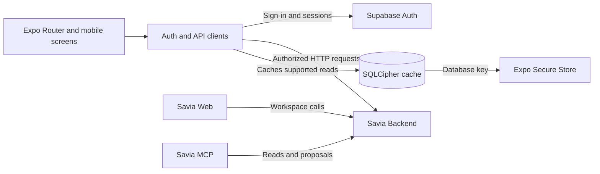

<!-- markdownlint-disable-next-line MD041 -->
<div align="center">

<h1>Savia Mobile</h1>

<p><strong>Track personal finances and review spending from Android and iOS.</strong></p>

<p>
<a href="https://github.com/diegnghtmr/savia-mobile/actions/workflows/ci.yml"></a>


<a href="LICENSE"></a>
</p>

<p>
<a href="https://diegnghtmr.me/en/work/savia/"><strong>Case study</strong></a> &bull;
<a href="#quick-start"><strong>Quick start</strong></a> &bull;
<a href="#architecture"><strong>Architecture</strong></a> &bull;
<a href="https://github.com/diegnghtmr/savia-backend"><strong>Backend API</strong></a> &bull;
<a href="https://github.com/diegnghtmr/savia-web"><strong>Web app</strong></a> &bull;
<a href="https://github.com/diegnghtmr/savia-mcp"><strong>MCP server</strong></a>
</p>

</div>

Savia Mobile puts a Savia finance workspace on a phone. Sign in to view balances, record expenses and transfers, and review the records those actions create. An encrypted on-device cache can reopen supported data you've already loaded when you lose connectivity.

## Features

- **Accounts and planning.** View balances, record transactions and transfers, manage budgets, funds, and debts, and confirm or dismiss detected subscription candidates.
- **Imports, exports, and receipts.** Import CSV statements, download completed exports, and review uploaded receipt images before confirming an expense.
- **Notifications.** Read the inbox and change notification preferences; push registration is an explicit action in Notification Settings.
- **Offline reads.** Reopen supported data from a SQLCipher cache whose database key is stored in Expo Secure Store.
- **Proposals and sessions.** Decide pending assistant proposals, view active sessions, and close other sessions.
- **Dashboard controls.** Choose and reorder cards, set a reporting period and display currency, and explore spending, cash flow, and advanced analytics.

## Quick start

Use Node.js **24.18.0** and pnpm **11.15.1** from [mise.toml](mise.toml), plus the Android or iOS native build tools. You need a Supabase Auth project and a [Savia API](https://github.com/diegnghtmr/savia-backend) reachable from the device or emulator. Set these build-time public values before starting Expo:

| Variable | Purpose | Default |
| --- | --- | --- |
| `EXPO_PUBLIC_SUPABASE_URL` | HTTPS origin of the Supabase project. | None |
| `EXPO_PUBLIC_SUPABASE_ANON_KEY` | Supabase publishable or legacy `anon` key; never a service-role key. | None |
| `EXPO_PUBLIC_SAVIA_API_URL` | API origin with no path; use HTTPS, or HTTP on loopback in development builds. | None |

If email confirmation is enabled, allow `co.savia.mobile://auth/callback` as a Supabase redirect. Build a native app rather than using Expo Go so the SQLCipher configuration is present:

```sh
git clone https://github.com/diegnghtmr/savia-mobile.git
cd savia-mobile
pnpm install --frozen-lockfile
pnpm exec expo run:android
```

On macOS with iOS build tools, use `pnpm exec expo run:ios` instead. Open the installed app and sign in. To register for push, use **Register this device** in Notification Settings from a non-development native build with an Expo project ID and notification permission.

## Architecture

Expo Router wires screens to the control flow in the mobile shell. The auth layer handles Supabase sessions, and the API client sends authorized workspace requests directly to the backend. Local data is a cache, not a second ledger.



## Tech stack

| Layer | Technology |
| --- | --- |
| App | Expo 57.0.8, Expo Router 57.0.8, React Native 0.86.0, React 19.2.3 |
| Language | TypeScript 6.0.3 |
| Identity and device storage | Supabase Auth, Expo Secure Store, Expo SQLite / SQLCipher |
| Testing | Jest 29.7.0, React Native Testing Library 14.0.1 |

## Testing

```sh
pnpm typecheck
pnpm run audit
pnpm audit:test
pnpm test
```

CI runs all four on Node.js 24.18.0. `pnpm run audit` checks repository boundaries, and `pnpm audit:test` tests those audit rules. Plain `pnpm audit` runs pnpm's dependency vulnerability check instead.

## Project structure

```text
src/app/          Expo Router entry points, screen wiring, and auth callback
src/foundation/   Auth, API clients, and encrypted offline storage
src/mobile-shell/ Screens and device integrations
__tests__/        Jest tests
scripts/          Repository audit and its tests
```

## Related repositories

- [savia-backend](https://github.com/diegnghtmr/savia-backend) — HTTP API and background worker.
- [savia-web](https://github.com/diegnghtmr/savia-web) — browser workspace and account setup.
- [savia-mcp](https://github.com/diegnghtmr/savia-mcp) — MCP interface for reads and proposals.
- [savia-cli](https://github.com/diegnghtmr/savia-cli) — command-line client.

## License

[MIT](LICENSE).
